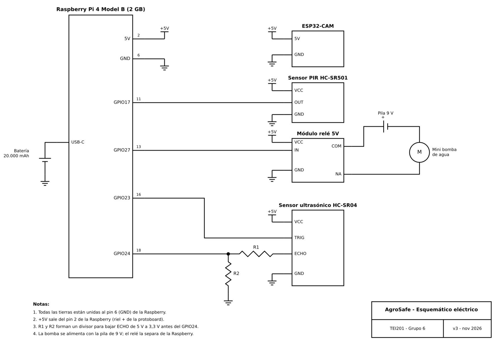

# Esquemas de Circuito

## Archivos
- `IMG_0765.jpeg` — esquemático eléctrico (imagen)

## Conexiones (referencia para dibujar el esquema)

| Desde | Hacia |
|---|---|
| RPi pin 2 (5 V) | Riel + protoboard → VCC PIR, VCC HC-SR04, VCC relé, 5V ESP32-CAM |
| RPi pin 6 (GND) | Riel − protoboard → GND PIR, GND HC-SR04, GND relé, GND ESP32-CAM, divisor |
| RPi pin 11 (GPIO 17) | OUT PIR |
| RPi pin 13 (GPIO 27) | IN del módulo relé (bomba + pila 9 V en contacto NA) |
| RPi pin 16 (GPIO 23) | TRIG HC-SR04 |
| ECHO HC-SR04 | R1 → nodo → pin 18 (GPIO 24); nodo → R2 → GND |

## Notas de diseño
- Divisor de voltaje: Vout = 5 V × R2 / (R1 + R2) ≈ 3,3 V, para que el ECHO del HC-SR04 no dañe el GPIO24.
