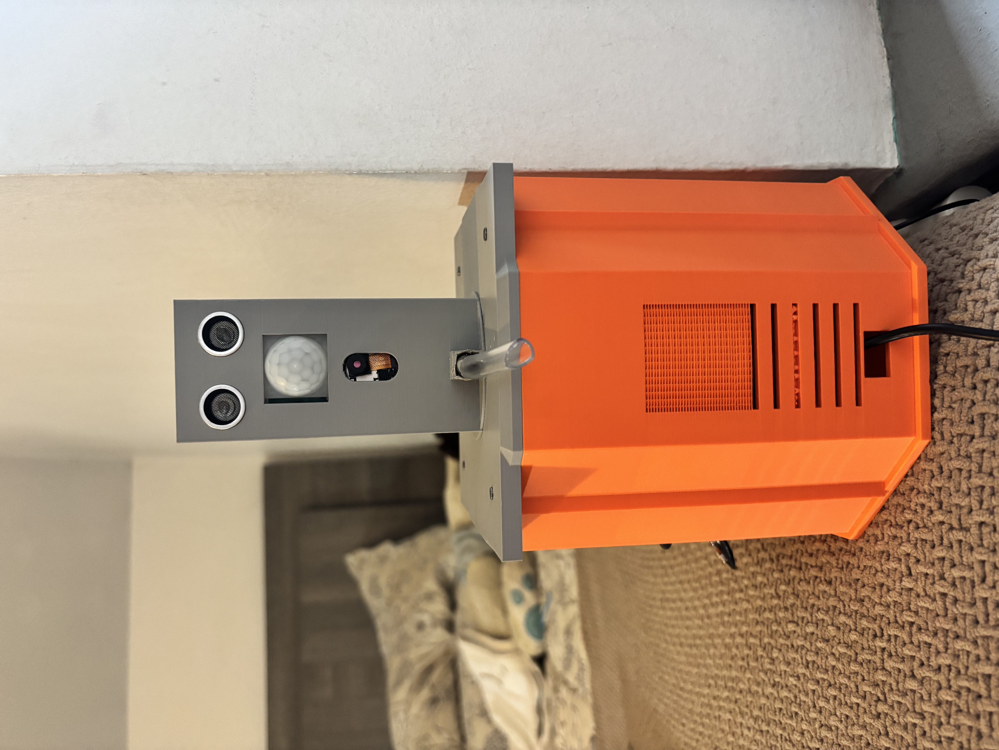
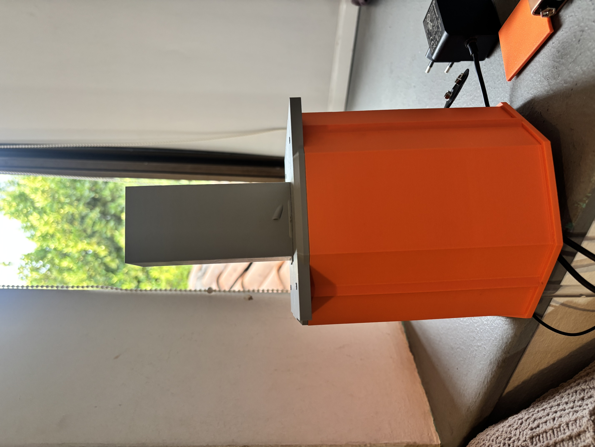
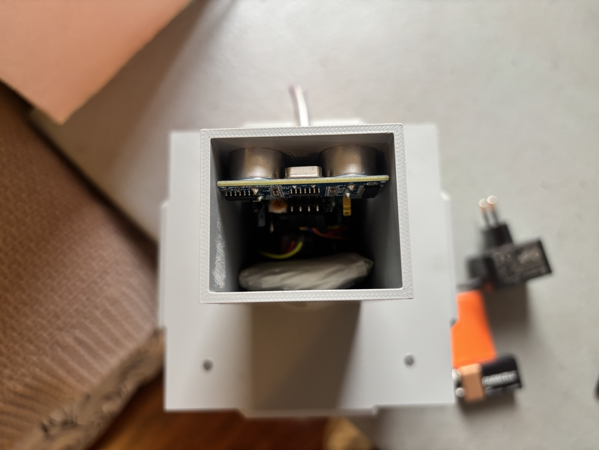
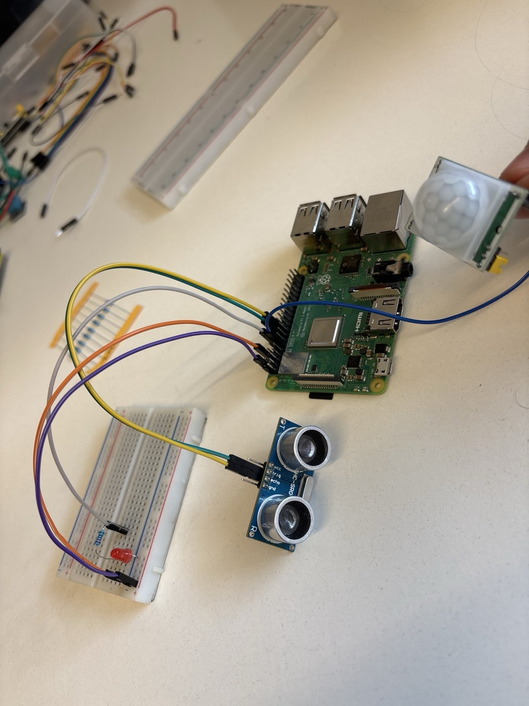
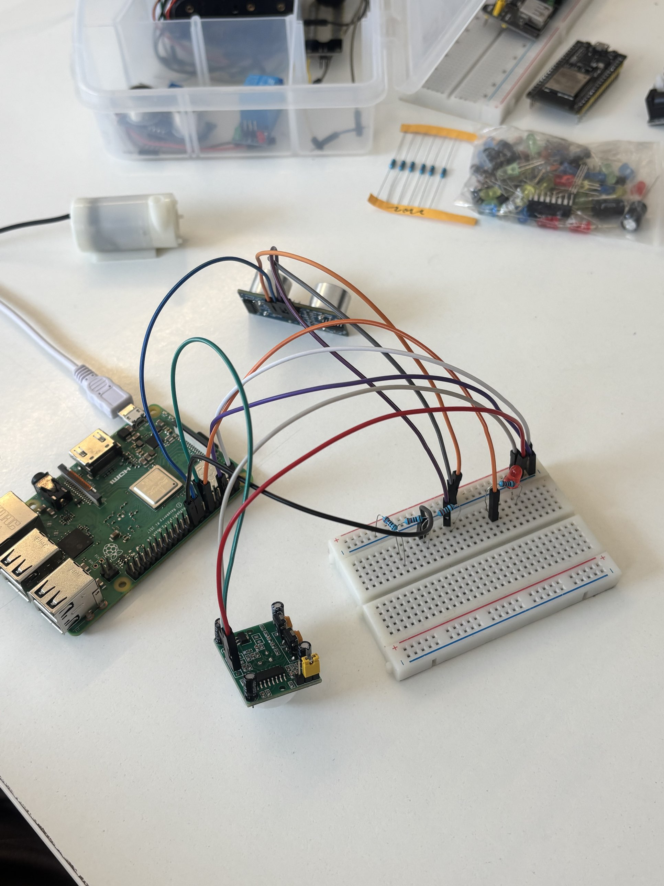
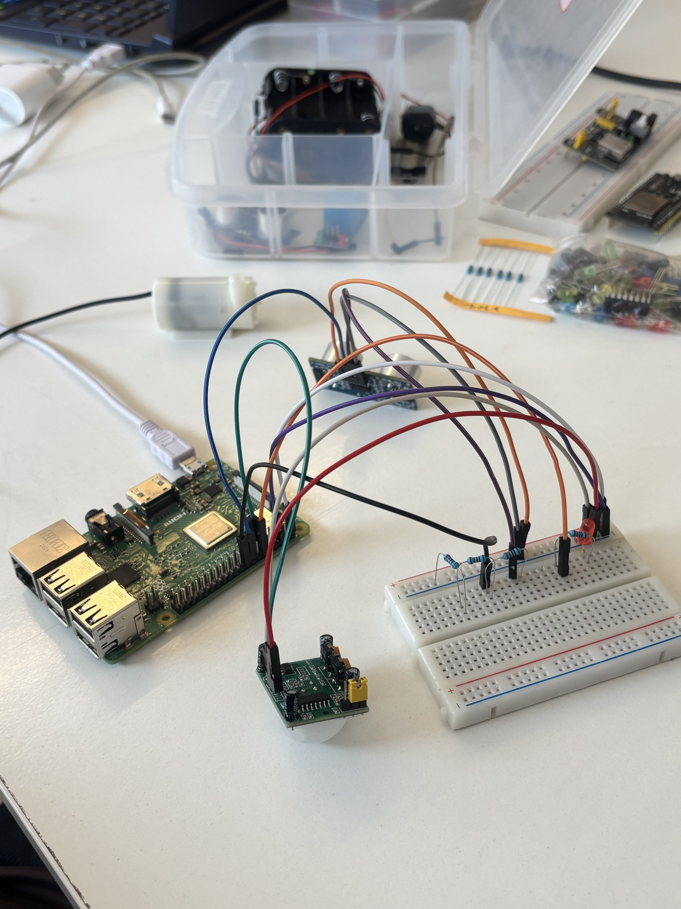

# Fotografías del Prototipo

## Prototipo final (v3)

| Archivo | Contenido |
|---|---|
| `IMG_5745.jpeg` | Vista frontal: en la torreta, el ultrasónico HC-SR04 arriba, el PIR al centro y la cámara de la ESP32-CAM abajo; bajo ella sale la manguera de la boquilla. Tapa gris fijada con tornillos sobre la base naranja, con la rejilla de ventilación y la salida de cables |
| `IMG_5746.jpeg` | Vista posterior: torreta y base cerradas |
| `IMG_5747.jpeg` | Vista superior sin la tapa de la torreta: el HC-SR04 y el PIR montados por dentro |

  
  
  

## Proceso de cableado

Pruebas del circuito en protoboard antes de montarlo en la carcasa. En esta etapa se usó un LED como indicador en lugar del relé y la bomba.

| Archivo | Contenido |
|---|---|
| `IMG_0760.jpeg` | Primera prueba: HC-SR04 y PIR conectados a la Raspberry, LED en la protoboard |
| `IMG_0759.jpeg` | Circuito completo de prueba: PIR, HC-SR04 con divisor de voltaje (resistencias) y LED |
| `IMG_0758.jpeg` | Mismo circuito desde otro ángulo; atrás la mini bomba y el resto de los componentes |

  
  
  

