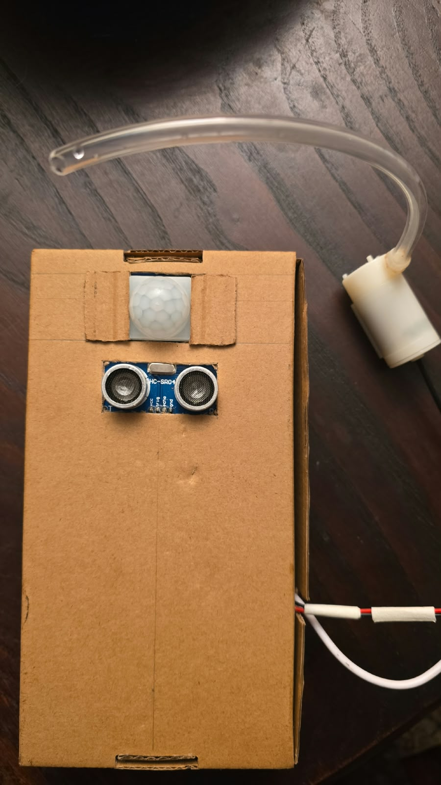

# Iteración 1 - Concepto Inicial

**Versión:** v1.0 · **Avance asociado:** Avance 1 / inicio Avance 2

Primer montaje en protoboard para validar la detección de movimiento.

## Componentes
- ESP32 + Raspberry Pi
- Sensor PIR HC-SR501
- Protoboard y cables jumper

## Problemas identificados
- Falsas activaciones: el PIR solo reacciona a cualquier movimiento en 3–7 m.
- ECHO del ultrasónico conectado directo a 5 V (riesgo para la Raspberry).
- Dos microcontroladores → mayor complejidad.
