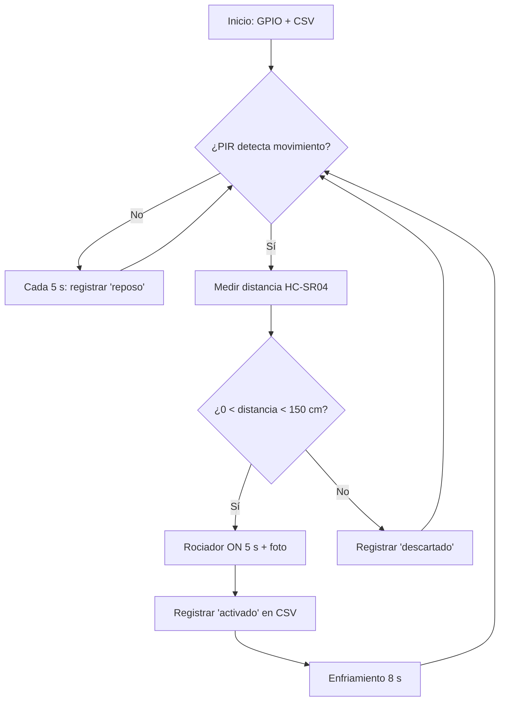

# Documentación de Software

## Diagrama de flujo

## Funciones principales

**`medir_distancia_cm()`** — Envía un pulso de 10 µs por TRIG y mide el tiempo del eco. Retorna `float` (cm) o `-1` si no hay eco en 50 ms.

**`registrar(estado, distancia, foto=False)`** — Crea el evento con fecha y hora, lo agrega a la lista en memoria y lo escribe en `data/eventos.csv`.

**`calcular_estadisticas()`** — Retorna un diccionario con: `activaciones_hoy`, `descartes_hoy`, `tasa_confirmacion`, `distancia_promedio`, `segundos_rocio_hoy`, `activaciones_ultima_hora`, `alerta`, `hora_peak`, `por_hora` (lista de 24 valores) e `historico_total`.

## Manual de operación

### Encendido
1. Conectar la batería de 20.000 mAh a la Raspberry Pi.
2. Esperar ~1 min a que inicie el sistema operativo.
3. Ejecutar `python3 agrosafe.py` (o dejarlo como servicio al inicio).
4. Abrir el dashboard en `http://<IP>:5000`.

### Lectura del dashboard
- **Estado actual:** verde = reposo, naranjo = descartado, rojo = activado.
- **Alerta roja:** ≥ 5 activaciones en la última hora → revisar el predio y el estanque.
- **Hora de mayor actividad:** permite reforzar la protección en ese horario.
- **Descargar datos (CSV):** para analizar varias noches en Excel o R.

### Apagado
`Ctrl + C` en la terminal (apaga el LED y libera los pines), luego `sudo shutdown now`.
