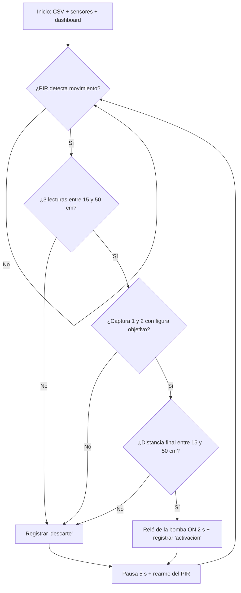

# Documentación de Software

## Diagrama de flujo

## Funciones principales

**`comprobar_distancia(pir, sensor)`** — Toma 3 lecturas cada 0,2 s y retorna `True` solo si todas están entre 15 y 50 cm.

**`evaluar(pir, sensor)`** — Verifica distancia, hace 2 capturas con `detectar_estrella()` y vuelve a verificar la distancia. Retorna `True` si se debe activar la bomba.

**`registrar(mensaje, tipo)`** — Agrega el evento al historial de la sesión y lo escribe en `data/eventos.csv` con fecha, hora, tipo y distancia.

**`calcular_estadisticas()`** — Retorna detecciones, activaciones y descartes del día, % de confirmación, segundos de bomba, activaciones de la última hora, alerta, hora de mayor actividad y activaciones por hora.

## Manual de operación

### Encendido
1. Encender la ESP32-CAM y conectar la batería a la Raspberry Pi.
2. Esperar ~1 min a que inicie el sistema operativo.
3. Ejecutar `python3 agrosafe.py`.
4. Abrir el dashboard en `http://<IP>:5000`.

### Lectura del dashboard
- **Estado:** fase actual del ciclo (esperando movimiento, comprobando distancia, analizando captura, activando bomba, pausa).
- **Alerta roja:** ≥ 5 activaciones en la última hora → revisar el predio y el estanque.
- **Hora de mayor actividad:** permite reforzar la protección en ese horario.
- **Descargar historial (CSV):** para analizar varias noches en Excel o R.

### Apagado
`Ctrl + C` en la terminal (apaga el relé y libera los pines), luego `sudo shutdown now`.
